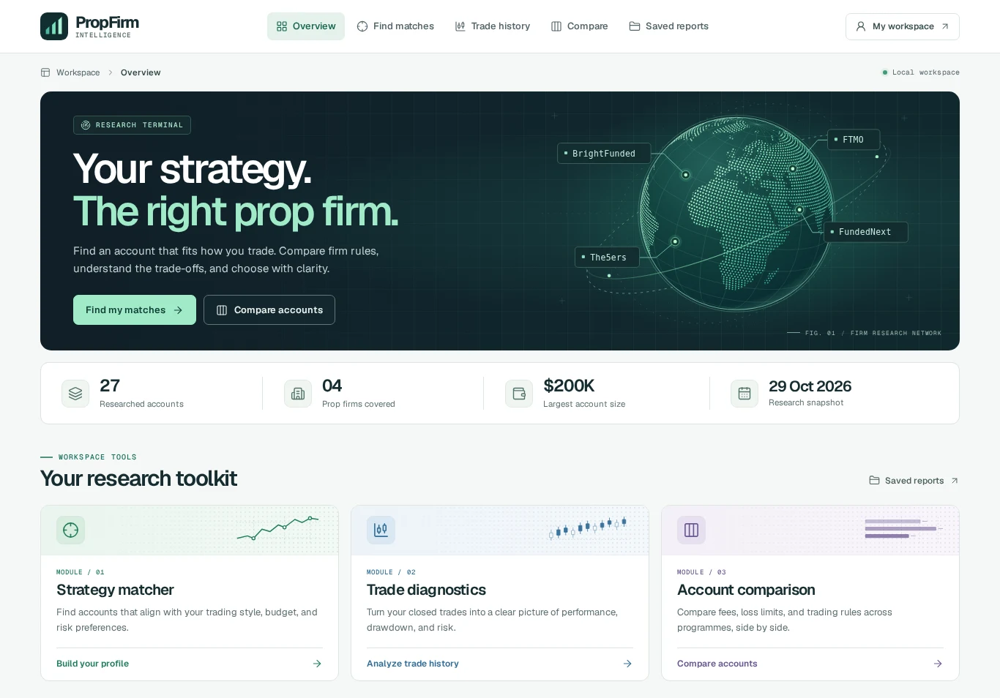

# PropFirm Intelligence

Research-driven Forex & CFD prop-firm advisory platform that conducts a strategy consultation, analyses closed-trade history, interprets official programme rules, evaluates operational risks, compares alternatives, and produces an evidence-backed recommendation.

## Using the workspace

- **Overview:** start a match, open trade diagnostics, or browse the firms and official sources in the research catalogue.
- **Find matches:** complete Strategy, Account fit, and Risk review. Use **Edit profile** to adjust your inputs, or name and save the resulting report.
- **Trade history:** choose a CSV (or **Load sample CSV**) to see a **Performance overview** immediately. It shows net realized P&L, return on the entered starting balance, win rate, profit factor, expectancy, balance drawdown, trade outcomes, and a daily P&L curve. Only valid, unique trades count. Review or remap columns to update the statistics, then choose **Analyze** to save the summary for matching and open the full report. Manual entries show the same overview after analysis. On refresh, confirmed statistics remain available; raw trades and the daily curve are never saved.
- **Compare:** use **Edit selection** to filter by firm or size. Remove a selected account before adding a fifth; the current comparison is never silently replaced.
- **Saved reports:** read, print, or delete a consultation in this browser. A local profile is optional.

## Core Advisory Capabilities

1. **Strategy Consultation & Contradiction Detection (`/matches`)**
   - Describe your trading methodology in natural language (setup identification, entry triggers, timeframes, sessions, stop-loss placement, reward-to-risk, holding duration, and conditions to stay flat).
   - Automatic extraction of timeframes, instruments, sessions, R:R, risk sizing, and holding cadence (`src/lib/strategy/consultation.ts`).
   - Dynamic follow-up questions when important details are missing or conflict with either profile settings or imported trade history.

2. **Empirical Trade-History Diagnostics (`/history`)**
   - [See the performance overview for the sample CSV](docs/trade-performance.webp).
   - Import a UTF-8 CSV (up to 5 MB / 10,000 trades) with column mapping and invalid/duplicate row inspection, or enter trades via the **Manual Trade Log Entry** builder.
   - Calculates net P&L, win rate, profit factor, expectancy, payoff ratio, realized R-multiple, risk consistency CV, holding duration (average, median, min, max), sub-30-second execution counts, overnight and weekend crossings, session performance (`Asian`, `London`, `London/NY Overlap`, `New York`, `Late/Rollover`), chronological first-half vs. second-half stability, best-day share, top-3-trade concentration, outlier loss ratio, and drawdown.
   - Generates plain-language behavioral findings grounded strictly in observed data while separating confirmed facts from estimates.

3. **Researched Prop-Firm Intelligence Database (`src/data/firms.ts`)**
   - 27 account-size/programme records across four firms: FTMO 1-Step and 2-Step (through $200K), FundedNext Stellar 2-Step (through $200K), The5ers High Stakes (through $100K), and BrightFunded 2-Step Bright (through $200K).
   - Research snapshot checked `2026-10-29` against official programme pages and help centres, including [FTMO 1-Step](https://ftmo.com/en/1-step-challenge/), [FTMO 2-Step](https://ftmo.com/en/2-step-challenge/), [FundedNext Stellar 2-Step](https://help.fundednext.com/en/articles/17255124-stellar-2-step-challenge), [FundedNext current offer](https://help.fundednext.com/en/articles/17560173-what-is-the-fundednext-stellar-october-returns-offer), [The5ers High Stakes](https://the5ers.com/high-stakes/), [The5ers drawdown rules](https://the5ers.com/faqs/what-is-the-drawdown-rule-for-high-stakes/), and [BrightFunded's plan comparison](https://brightfunded.com/comparison-table).
   - Each verified rule stores its own source URL and verification date. Unknowns—including The5ers larger account fees, account-specific automation/consistency details, and a FundedNext $200K fee discrepancy—remain explicitly marked `unverified` and block blind purchase recommendations.

4. **Personalised Advisory Report & 4-Part Rule Breakdown (`src/lib/matching/report.ts`)**
   - **9-Point Executive Thesis** explaining the recommended account, why its drawdown structure fits the trader's behaviour, how restrictions interact with holding times and sessions, what the CSV reveals, known disadvantages, and research confidence.
   - **A / B / C / D Rule Breakdown** across 8 material rule domains (A. What the rule says · B. What it means in practice · C. What it means for this trader · D. How to manage the restriction).
   - **Risk & Scenario Analysis** including daily loss buffer, consecutive-loss survival, losing-streak compounding stress tests, and a pre-purchase readiness verdict.
   - **Alternative Account Reasoning & Financial Trade-Offs** comparing why runner-up accounts rank lower and calculating cost per $1,000 of usable drawdown room.

5. **Side-by-Side Programme Matrix (`/compare`) & Trader Workspace (`/reports`)**
   - Compare up to 4 specific account records side by side across all verified rules and source citations.
   - Local-first Trader Workspace profile and Saved Advisory Dossiers archive (never requests broker passwords or trading-account credentials).

## Development

Run `npm ci` and `npm run dev` for local development. Run `npm test` for matching, consultation, report, and trade-history tests, `npm run lint` for linting, and `npx tsc --noEmit` for TypeScript checks. `npm run build` followed by `npm start` serves the production build. Both development and production compile Tailwind through PostCSS; fonts and illustrations are served locally.

For desktop and phone browser regression tests, run `npx playwright install chromium` once, then `npm run test:ui`. This builds the production app and starts an isolated `next start` server on port 3100. The tests check that the compiled styles render, the globe loads, and the import, comparison, and report workflows respond to input. They do not reuse a development server. Set `CHROMIUM_PATH` to use an existing Chromium installation instead.

## Preview vs. production

This project's Vercel production branch is `master`. A pull request has its own preview URL; it does not update [the public site](https://propfirmintelligenence.vercel.app) until the change is merged and the production deployment is ready. The redesigned overview has a light navigation bar and the heading **“Your strategy. The right prop firm.”**
